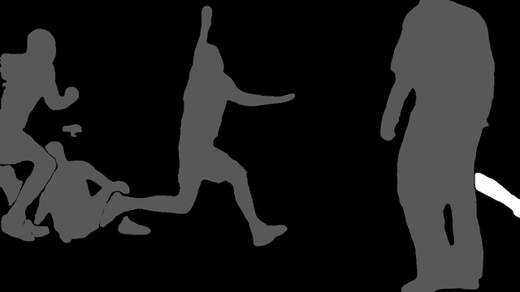
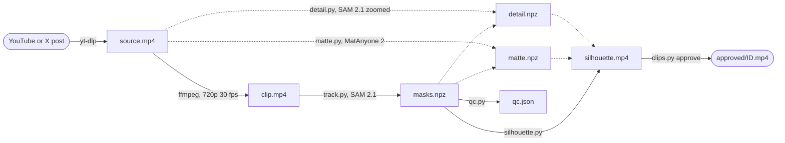

# video-segmentation-pipeline

[](https://github.com/Tominthomas/video-segmentation-pipeline/actions/workflows/python.yml)
[](LICENSE)

Turn a basketball highlight into a silhouette clue. The player to guess and the ball draw in white, the other players in dark gray and the hoop in light gray, all on black, with the crop following the play.

<p align="center">
	
</p>

[SAM 2.1](https://github.com/facebookresearch/sam2) tracks every object from a few click points. A matting pass or a zoomed second SAM pass then sharpens the edge of the player to guess. The renders are the daily clues in Bagwork, a guess-the-player game.

## How it works

`clips.py` runs every step. Each step writes one file to `media/clips/<id>/`, and a rerun rebuilds only the files whose inputs changed. A change to the look re-renders in seconds and never runs a model again.



The dotted steps are optional. A clip draws the player to guess from at most one of them, picked by his size in the frame. [docs/SPEC.md](docs/SPEC.md) explains each step and the measurements behind its settings.

## Install

The pipeline runs on a Mac with Apple Silicon, where SAM uses the Apple GPU. On Linux, `clips.py` reads free memory from `/proc/meminfo` and SAM runs on CUDA when it is available, but that path is untested. `SAM_DEVICE` sets the torch device by hand.

1. Install the tools:

	```sh
	brew install python@3.14 ffmpeg yt-dlp ruff ty
	```

2. Create the SAM venv. It lives outside the checkout, so every worktree on the machine shares it:

	```sh
	S=~/.local/share/bagwork/sam
	python3.14 -m venv $S/venv
	SAM2_BUILD_CUDA=0 $S/venv/bin/pip install --no-deps -r sam-requirements.txt
	```

	`--no-deps` holds every package to its pin. Before each step that uses the venv, `clips.py` checks the venv against `sam-requirements.txt` and stops at the first package that differs. The SAM 2.1 large weights download from Hugging Face on the first track.

3. Optionally, install matting. [docs/SPEC.md](docs/SPEC.md#matting) has the steps. MatAnyone 2 allows non-commercial use only. Without it, a clip that would use the matte draws SAM's shape, and the build says why.

SAM 2.1 large needs about 10 GB of free memory. It peaked at 7.8 to 10.0 GB on four test clips. `clips.py` runs one SAM job at a time and waits until 30% of memory is free. Set `BAGWORK_MIN_FREE` to change that percentage.

## Build the sample clips

`fixtures/clips.json` holds two public sample clips. Build both:

```sh
python3 clips.py build
```

Each clip gets a folder under `media/clips/<id>/`, which git ignores:

| File | What it holds |
|---|---|
| `source.mp4` | the fetched window, at up to 1080p |
| `clip.mp4` | the window at 720p and 30 fps, with audio |
| `thermal.mp4` | a blurred heat-map clue, silent |
| `contact.png` | a contact sheet of frames |
| `masks.npz` | SAM's masks, for a clip with a `track` entry |
| `silhouette.mp4` | the silhouette render, for a clip with a `track` entry |

Tracking takes about 0.5 seconds per object per frame on an M4. The replay has 198 frames and 11 objects, so expect its first build to take about 20 minutes. Later builds reuse the cached masks. Each build checks the size, duration, audio and metadata of every output, and checks `silhouette.mp4` against [the render contract](#the-render-contract).

To see the masks, an overlay and the QC flags in a browser, run `python3 clips.py review <id>`.

## Add your own clip

1. Find the moment. `python3 clips.py scout <url>` saves one frame per second and prints the path of a `sheet.html` labelled by second. Skip this step for a clip that is already cut.
2. Add an entry. `python3 clips.py add --manifest FILE <url> --player NAME` scouts the post and appends a stub. `add` has no default manifest, so an entry never lands in `fixtures/clips.json` by accident. Set `start` and `end`, or leave both out for the whole video.
3. Pick the prompts. `python3 clips.py propose --manifest FILE <id> --frame N` draws numbered boxes around the players and the ball. Add a `track` entry, as [docs/MANIFEST.md](docs/MANIFEST.md#track) describes, and mark the player to guess with `"mystery": true`.
4. Check the prompts. `python3 clips.py preview --manifest FILE <id>` shows each prompt's mask on its frame before a full track.
5. Build. `python3 clips.py build --manifest FILE <id>`.

If a mask drifts, add a `refine` to the object. A refine changes the object's cache key, so the next build tracks that object again over the whole clip. To check a refine first, run `python3 clips.py window --manifest FILE <id> --frames 150-180:3 --objects 2`. It tracks only the listed objects over those frames and writes `window.png`, with no change to the cached masks. If SAM loses the ball in a crowd, `python3 clips.py crops --manifest FILE <id> --frames 140-160:4 --box x0,y0,x1,y1` writes gridded zooms to read `ball_keys` off.

Replay angles make better clues than the wide broadcast shot. The player is bigger and there is no score bug.

## Find your way around

| File | Job |
|---|---|
| `clips.py` | the command line, the artifact cache, the SAM slot and the render contract |
| `track.py` | tracks every object through the clip with SAM 2.1 and writes `masks.npz` |
| `matte.py` | mattes the player to guess with MatAnyone 2 on a crop of the full-resolution source |
| `detail.py` | runs SAM 2.1 again on a zoomed crop that follows the player to guess |
| `silhouette.py` | plans the crop and draws each frame from the masks |
| `qc.py` | flags the frames where a mask looks wrong, and a matte or detail pass that struggled, in `qc.json` |
| `review.py` | writes `review.html`, an overlay with the QC flags |
| `propose.py`, `crops.py` | draw the numbered boxes and gridded zooms used to pick prompts |
| `judge.py` | scores the shape thresholds against recorded human verdicts |
| `leaks.py` | checks the repo and unpushed commits for real players |

`clips.py` runs each worker as its own process in the SAM venv, with a JSON spec in and one file out. A worker never reads the manifest.

## The render contract

Bagwork serves a render only when all of these hold:

- It is under 2,000,000 bytes, because the game streams every clip whole to a phone.
- ffprobe reads exactly one stream, and it is video. There is no audio, subtitle or data track.
- It has no chapters.
- Every tag on the container and the stream is one that ffmpeg writes by default: `major_brand`, `minor_version`, `compatible_brands`, `encoder` (`Lavf` or `Lavc`, with an optional ` libx264`), `handler_name` (`VideoHandler`), `language` and `vendor_id`. Any other tag or value is free text that could name the player.

`silhouette.mp4` from `clips.py build` meets the stream, chapter and tag rules as it is. A long clip can still go over the byte limit, and `build` reports that as a failure.

`python3 clips.py approve --manifest FILE <id> ...` checks each clip's `silhouette.mp4` against the contract. It copies the passing ones to `$BAGWORK_CONTENT/approved/<id>.mp4`, prints why each failing one was refused, and exits 1 if any failed. `render_problem` in `clips.py` is the check.

## Keep players secret

A clip id, a manifest and a render all name the player, so keep real manifests outside the repo. Before you push, run:

```sh
python3 leaks.py ~/path/to/manifests
```

`leaks.py` reads every manifest in that folder and fails if a tracked file, or a commit message not yet on `origin/main`, names one of their players or clip ids. The players in `fixtures/clips.json` are public, so it skips them.

## Develop

The checks run in the SAM venv:

```sh
SAM_PY=~/.local/share/bagwork/sam/venv/bin/python
ruff check && ruff format --check
ty check --python $SAM_PY
$SAM_PY -m unittest discover tests
python3 clips.py --help
```

CI runs the same checks on every pull request and on every push to `main`. A pin change in `sam-requirements.txt` also needs a bump of `TRACK_VERSION` in `clips.py`, because masks are cached by that number and not by the package versions. `tests/test_clips.py` fails until you bump it.

Before you change a threshold in `detail.py` or `qc.py`, score it against the recorded verdicts with `$SAM_PY judge.py <judgments.json> <manifest> ...`. It prints which verdicts the change breaks. [docs/SPEC.md](docs/SPEC.md#judgments) describes the file.

## License

The code is under the [MIT License](LICENSE). SAM 2.1 is under the Apache License 2.0. MatAnyone 2, used only by the optional matting step, is under the S-Lab License 1.0, which allows non-commercial use only. You need the rights to any footage you process.
